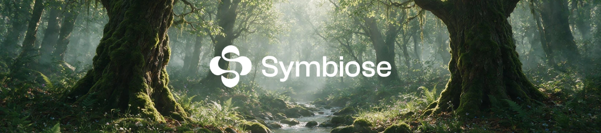

# Symbiose

**Observer le vivant. Comprendre ses interactions. Repenser nos territoires.**

Prototype local reliant biodiversité et choix d’aménagement.
Présenté par l’**équipe ARQ au Datathon Normandie 2026**.

## Que change une observation dans nos décisions ?

Un renard traverse une parcelle. Une clôture se prépare. Comment rapprocher ces deux
informations ? Entre vidéos, cartes environnementales et publications scientifiques,
les connaissances restent dispersées. Leur donner un
sens à l’échelle d’un projet demande de les relier, vérifier et comprendre
ce qu’elles permettent de conclure.

## Notre vision

Nous partageons nos territoires avec un vivant dont les besoins nous échappent
souvent. Symbiose veut lui donner une place dans nos réflexions, avant les travaux.

L’observation ouvre le dialogue : que savons-nous du lieu, que reste-t-il à vérifier,
quelles adaptations pouvons-nous envisager ? Nous voulons rendre ces
questions accessibles aux collectivités, propriétaires, agriculteurs, aménageurs et
naturalistes, pour éclairer leurs décisions.

## Observer → Comprendre → Anticiper → Agir

**Observer.** Après préparation des modèles locaux, importer ses vidéos de pièges
photographiques, repérer les animaux et consulter une vidéo annotée.
L’identification propose une espèce parmi dix classes ; une personne vérifie l’espèce
et corrige le recadrage. Détection, identification et suivi temporel restent distincts.

**Comprendre.** Rassembler les vidéos d’une parcelle dans un dossier, renseigner son
projet et consulter les publications associées aux espèces. Les observations
confirmées restent distinguées des prédictions.

**Anticiper.** Situer un point sur la carte et examiner les zonages environnementaux
et l’inventaire des zones humides. Le projet déclaré déclenche des vérifications ;
un point ne décrit pas toute l’emprise des travaux.

**Agir.** Examiner des alternatives : revoir une clôture, limiter l’éclairage,
préserver la végétation ou réduire les surfaces imperméabilisées. Chaque option
précise ses conditions et son niveau de justification. Le dossier conserve les
sources et s’exporte pour en discuter.

## Pourquoi la Normandie ?

Bocages, prairies, forêts et zones humides invitent à penser ensemble les usages et
les milieux. Symbiose mobilise le cadastre, le registre parcellaire graphique, les
zonages IGN et l’inventaire DREAL Normandie. **La valeur vient de leur rapprochement
avec un projet concret**, pour repérer les questions à approfondir avant les travaux.
Le bénéfice écologique reste à évaluer sur le terrain.

## Une approche responsable

Les sources, dates et corrections humaines sont conservées. Un nom de vidéo ne
valide jamais une espèce. Une donnée absente ne prouve pas l’absence de biodiversité.
Les alternatives restent conditionnelles ; la compensation n’est pas évaluée.
**L’humain garde la décision.**

La synthèse scientifique automatisée reste expérimentale : citations contrôlées et
sources en attente de validation sont signalées, mais l’interprétation exige une
relecture. Les exemples du guide et les paysages du récit jury sont illustratifs ;
les écrans métier utilisent les données enregistrées. Hydrophones et caméras
immergées sont des perspectives.

Les traitements s’exécutent localement, sans entraînement automatique, avec une seule
tâche de calcul lourde sur la carte graphique à la fois. Leur consommation énergétique
reste à mesurer.

## Explorer le projet

| Pour découvrir… | Ressources |
| --- | --- |
| L’interface et les parcours | [Console web](WEB_CONSOLE.md) |
| L’analyse et les dix espèces | [Vision](workers/vision/README.md) · [Inférence vidéo](workers/vision/INFERENCE.md) |
| La validation humaine | [Corrections, historique et exports](HUMAN_REVIEW.md) |
| Les parcelles et dossiers biodiversité | [Parcours vidéo → parcelle → dossier](docs/PARCEL_DOSSIERS.md) |
| Les données territoriales | [Contexte IGN](docs/TERRITORIAL_CONTEXT.md) · [Zones humides normandes](docs/DREAL_WETLANDS.md) · [Preuves et limites](docs/TERRITORIAL_VALIDATION.md) |
| Les adaptations du projet | [Alternatives et conditions](docs/PROJECT_DESIGN.md) |
| La recherche scientifique | [Bibliothèque documentaire](workers/documents/README.md) · [Recherche et synthèse locale](docs/RAG.md) |
| L’architecture et l’installation | [Installation, services et exploitation](INSTALLATION_SYMBIOSE.md) · [Accès et comptes](docs/AUTHENTICATION.md) |
| Les modèles et l’évaluation | [Entraînement](workers/vision/TRAINING.md) · [Comparaison des classificateurs](workers/vision/CLASSIFICATION_ALTERNATIVE.md) |
| La présentation du jury | [Parcours autonome](frontend/README.md) · [Guide du présentateur](docs/PRESENTER_GUIDE.md) · [État de livraison](docs/FINAL_DELIVERY.md) |

**Faire une place au vivant dans les choix qui dessinent nos territoires.**
